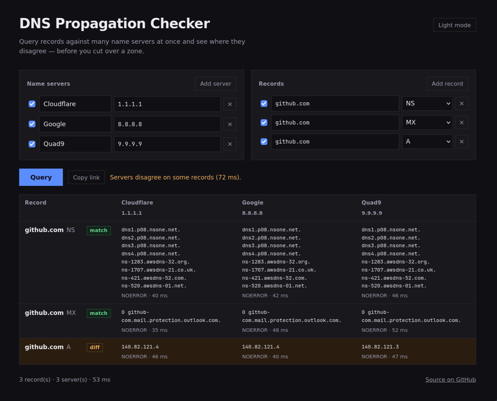

# DNS Propagation Checker

Query DNS records against many name servers at once and see where they
disagree, before you cut a zone over to new nameservers.

One static Go binary. Mostly a CLI, with a web UI embedded in the same binary
for when a browser is handier. It also ships as a `scratch` Docker image of
about 7 MB (3 MB compressed), where the binary is the whole image.

```
$ dnspc check example.com:NS example.com:MX @8.8.8.8 @1.1.1.1
example.com NS  MATCH
  8.8.8.8       a.iana-servers.net.  NOERROR 24ms
                b.iana-servers.net.
  1.1.1.1       a.iana-servers.net.  NOERROR 19ms
                b.iana-servers.net.

example.com MX  DIFF
  8.8.8.8       0 .                  NOERROR 21ms
  1.1.1.1       10 mail.example.com. NOERROR 18ms

2 record(s) in 31ms
```

The same binary serves a web UI with `dnspc serve`:



## Install

### From source

```bash
git clone https://github.com/jeliasson/dns-propagation-checker.git
cd dns-propagation-checker
make build
./dist/dnspc check example.com:NS
```

Requires Go 1.25+.

### Docker

```bash
docker run --rm ghcr.io/jeliasson/dns-propagation-checker check example.com:NS
```

### Nix

Run it without installing anything:

```bash
nix run github:jeliasson/dns-propagation-checker -- check example.com:NS
```

Or keep it around:

```bash
nix profile install github:jeliasson/dns-propagation-checker
```

The flake also exposes `overlays.default` for `pkgs.dnspc`, and
`nixosModules.default` with `programs.dnspc.enable = true;` to put `dnspc` on
PATH system wide.

## CLI

```
dnspc check [flags] <name>[:TYPE]... [@server]...
dnspc serve [flags]
dnspc healthcheck [flags]
dnspc version
```

A positional argument starting with `@` is a name server; anything else is a
name to look up. A name may carry its type inline as `example.com:MX`, or you
can apply types to every bare name with `-t`.

```bash
# A record against the default resolvers (Cloudflare, Google, Quad9)
dnspc check example.com

# Several types at once
dnspc check example.com -t A,AAAA,MX

# Compare the registrar's nameservers against the public resolvers
dnspc check example.com:NS @8.8.8.8 @ns1.registrar.net @1.1.1.1

# Label a column so the output is readable
dnspc check example.com @old=198.51.100.1 @new=203.0.113.1

# Non-standard port
dnspc check example.com @127.0.0.1:5353

# Machine readable
dnspc check example.com:NS --json | jq '.records[].answers[].values'
```

### `check` flags

| Flag            | Default | Meaning                                              |
| --------------- | ------- | ---------------------------------------------------- |
| `-t`, `-type`   | `A`     | Types for bare names, comma separated or repeated    |
| `-s`, `-server` | none    | Name server; same as an `@server` positional         |
| `-json`         | `false` | Emit the raw result instead of a table               |
| `-timeout`      | `5s`    | Per-query timeout                                    |
| `-fail-on-diff` | `false` | Exit `2` when the servers disagree (useful in CI)    |

Flags may appear anywhere, including after the names.

### Exit codes

| Code | Meaning                                              |
| ---- | ---------------------------------------------------- |
| `0`  | Ran successfully                                     |
| `1`  | Bad input, or the run could not start                |
| `2`  | Servers disagreed, and `-fail-on-diff` was set       |

So a propagation gate in CI is just:

```bash
dnspc check example.com:NS @8.8.8.8 @1.1.1.1 @9.9.9.9 --fail-on-diff
```

## Server

The same binary also serves the embedded web UI and a JSON API, if you want
the checker in a browser instead of a terminal.

```bash
dnspc serve                                                     # localhost:3000
docker run --rm -p 3000:3000 ghcr.io/jeliasson/dns-propagation-checker
docker compose up --build                                       # from a clone
```

On NixOS, `services.dnspc.enable = true;` runs it as a systemd unit under a
`DynamicUser` with no capabilities and a read-only filesystem. Its options
(`address`, `port`, `openFirewall`, `logLevel`, `trustProxy`, `extraArgs`) are
in `flake.nix`.

| Flag            | Env                 | Default | Meaning                                         |
| --------------- | ------------------- | ------- | ----------------------------------------------- |
| `-addr`         | `DNSPC_ADDR`        | `:3000` | Listen address                                  |
| `-timeout`      | none                | `5s`    | Per-query DNS timeout                           |
| `-rate-burst`   | none                | `20`    | Requests per window, per client                 |
| `-rate-window`  | none                | `1m`    | Rate limit window                               |
| `-trust-proxy`  | `DNSPC_TRUST_PROXY` | off     | Take the client IP from `X-Forwarded-For`       |
| `-log-level`    | `DNSPC_LOG_LEVEL`   | `info`  | `debug`, `info`, `warn` or `error`              |

Only enable `-trust-proxy` behind a proxy you control. Otherwise any client
can set the header and sidestep the rate limit.

### API

`POST /api/query`

```bash
curl -s localhost:3000/api/query -H 'content-type: application/json' -d '{
  "servers": [{"name": "Google", "address": "8.8.8.8"},
              {"name": "Cloudflare", "address": "1.1.1.1"}],
  "records": [{"fqdn": "example.com", "type": "NS"}]
}' | jq
```

```json
{
  "records": [
    {
      "record": { "fqdn": "example.com", "type": "NS" },
      "answers": [
        {
          "server": { "name": "Google", "address": "8.8.8.8" },
          "values": ["a.iana-servers.net.", "b.iana-servers.net."],
          "rcode": "NOERROR",
          "duration_ms": 24
        }
      ],
      "diff": false
    }
  ],
  "diff": false,
  "duration_ms": 31
}
```

`servers` may be omitted to use the defaults. A server that cannot be reached
gets an `error` on its own answer rather than failing the request, and always
counts as a `diff`, since an unreachable server has not been shown to agree.

Other endpoints: `GET /api/defaults` (the UI's starting state and limits) and
`GET /healthz`.

Limits per request: 32 records, 16 servers, 64 KB body, 20 requests/minute per
client.

## How it works

DNS queries are real DNS packets via [`miekg/dns`][miekg], sent in process.
Every record/server pair is queried concurrently (16 in flight), with a TCP
retry when a UDP reply comes back truncated.

Two answers agree when they carry the same response code and the same set of
records; the set is sorted first, so servers returning the same data in a
different order are not reported as a difference. `diff` on a record means at
least one server disagreed or did not answer.

The frontend is plain HTML, CSS and JavaScript in [`web/`](web/), compiled in
with `go:embed`. There is no build step and no framework. Configuration lives
in the URL as a base64 `?settings=` parameter, so a set of servers and records
can be shared as a link. That is the one idea worth keeping from the original
Vue version.

### Layout

```
cmd/dnspc            entry point
internal/resolve     DNS querying, validation, diffing
internal/server      HTTP handlers, rate limiting
internal/cli         check / serve / healthcheck commands
web                  embedded frontend
```

`flake.nix` and `package.nix` carry the nix package, the devshell and the
NixOS module.

### Development

```bash
make test     # go test ./...
make race     # with the race detector
make lint     # go vet + gofmt check
make cover    # coverage summary
make docker   # build the scratch image and print its size
```

With nix, `nix develop` gives you Go and `gopls`, and `nix flake check` builds
the package, which runs the test suite in its check phase.

The resolver tests spin up an in-process DNS server on loopback, so the suite
needs no network.

## History

This started in 2019 as a Nuxt/Vue app whose Express backend shelled out to
`dig` through `shelljs`, serialised over a ~1 GB Debian image. It was rewritten
in Go in 2026 with vibes.

## Licence

[MIT](LICENCE.md)

[miekg]: https://github.com/miekg/dns
